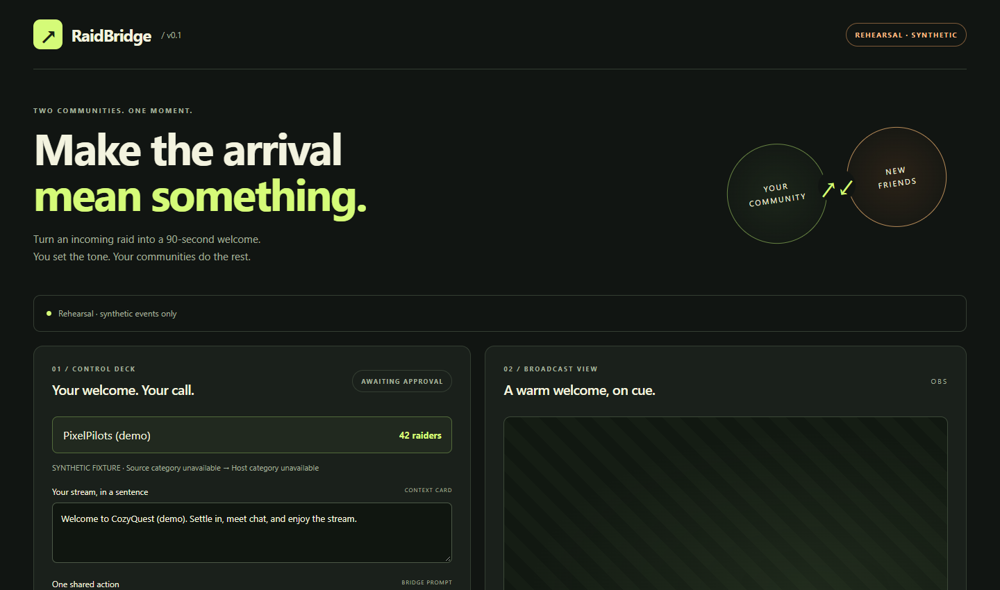
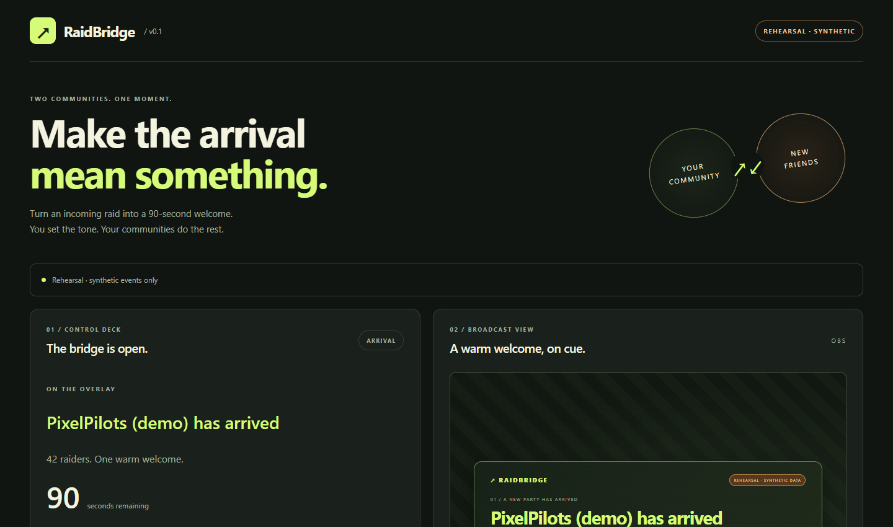
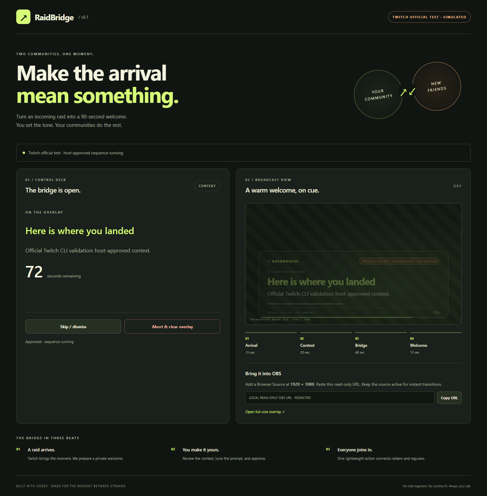

# RaidBridge

**Turn every Twitch raid into a 90-second shared onboarding ritual.**

RaidBridge owns one Twitch-native moment: the transition after an incoming raid. Instead of immediately throwing generic “welcome raiders” messages onto the broadcast, it gives the receiving streamer a private proposal, keeps the broadcast unchanged until the streamer approves, then runs a bounded four-stage OBS overlay that helps two communities connect.

## Product preview

### Private host approval



### Approved raid transition



### Official Twitch CLI EventSub validation



This evidence uses Twitch's official CLI WebSocket test server. It is intentionally labeled **simulated** and is separate from the production Twitch connection proof.

## The loop

1. Twitch EventSub reports an incoming `channel.raid` event.
2. RaidBridge validates the event, recipient, timestamp and message shape.
3. A **private** proposal appears in the host control deck.
4. The host can edit the context and shared action, then **approve**, **skip**, or **abort**.
5. Only after approval does the OBS/browser-source overlay run:
   - **Arrival — 15s:** who raided + raid size
   - **Context — 20s:** host-approved receiving-stream context
   - **Bridge — 40s:** one lightweight shared action for raiders and regulars
   - **Welcome — 15s:** clean completion and return to the stream
6. The overlay disappears after exactly 90 seconds or immediately on abort.

## Why RaidBridge

Raids already move viewers between channels. RaidBridge focuses on the harder social problem: helping the incoming group and the existing community become one room quickly without taking control away from the streamer.

It is intentionally **not** a generic chatbot, poll engine, prediction game, trivia system or chaos overlay. The product stays small and specific: make the raid transition itself better.

## Current validation status

Verified locally on Windows:

- TypeScript build: **PASS**
- Automated tests: **40/40 PASS** across engine, EventSub lifecycle, HTTP trust boundary and Twitch OAuth/Helix coverage
- Genuine Twitch OAuth authorization and token identity validation: **PASS** (`@mikehunter77`)
- Genuine Twitch EventSub WebSocket welcome + `channel.raid` subscription creation: **PASS**
- Official Twitch CLI WebSocket raid simulation through private proposal → host approval → read-only overlay: **PASS**
- Official-test provenance remains distinct from both live and local rehearsal data: **PASS**
- Dependency audit: **0 vulnerabilities**
- Brave browser rehearsal journey: **PASS**
- Private proposal remains invisible to the overlay before approval: **PASS**
- Embedded OBS preview after approval: **PASS**
- Live-mode synthetic injection rejection: **PASS**

**Not yet claimed:** a genuine incoming Twitch raid notification has not yet been observed by this build. RaidBridge has validated real Twitch OAuth and the real EventSub subscription path, plus Twitch's official simulated EventSub raid path, but deliberately keeps all three evidence levels distinct.

## Architecture

```text
                       PRIVATE HOST SURFACE
┌───────────────┐      ┌──────────────────────┐
│ Twitch OAuth  │─────▶│ RaidBridge control   │
└──────┬────────┘      │ deck                 │
       │               │ approve/skip/abort   │
       │               └──────────┬───────────┘
       ▼                          │ host approval
┌───────────────┐                 ▼
│ EventSub WS   │──────▶┌─────────────────────┐
│ channel.raid  │       │ deterministic engine│
└───────────────┘       │ + idempotency       │
        │                └──────────┬──────────┘
        │ optional Helix metadata   │ approved public state only
        └───────────────────────────┤
                                    ▼
                         ┌─────────────────────┐
                         │ OBS browser source  │
                         │ read-only overlay   │
                         └─────────────────────┘
```

### Main modules

- `src/engine.ts` — raid parser, provenance, idempotency, private proposal, deterministic 90-second state machine, approve/skip/abort
- `src/eventsub.ts` — EventSub WebSocket lifecycle, keepalive timeout, trusted reconnect migration, bounded retry, revocation handling
- `src/twitch.ts` — OAuth authorization-code exchange, token validation/refresh, EventSub subscription creation, selective Helix metadata
- `src/server.ts` — local trust boundary, dashboard session, OAuth callback state, read-only overlay token, same-origin mutation controls
- `public/` — host control deck and OBS/browser-source overlay
- `tests/` — trust, timing, duplicate, reconnect, OAuth and HTTP boundary tests

## Trust and reliability boundaries

RaidBridge treats broadcast output as a privileged side effect.

- Nothing is rendered publicly before host approval.
- Raw Twitch chat is not ingested or rendered.
- Repeated EventSub notifications are idempotent by message ID and provenance.
- Malformed, stale, future-dated or wrong-recipient raid events fail closed.
- Overlapping raids are not placed into an unbounded queue.
- Host approval expires after two minutes.
- Host can abort the sequence immediately.
- Rehearsal, official Twitch CLI test, and live inputs carry explicit provenance.
- Rehearsal data is always labeled synthetic.
- Official Twitch CLI test data is always labeled simulated and never presented as a live viewer raid.
- The official-test lane does not query production metadata or use production OAuth/subscription calls.
- Live-mode failure never silently falls back to synthetic evidence.
- A caller-supplied official-test WebSocket endpoint remains isolated across retries; production reconnect URLs are accepted only for Twitch's expected secure endpoint.
- Twitch credentials and tokens remain server-side and `.env` is excluded from Git.
- The dashboard and overlay use separate random local access keys.
- The OAuth callback is authorized by a short-lived one-time `state` value rather than depending on a cross-site cookie.
- After a valid OAuth state and successful authorization, the callback restores the protected HttpOnly `SameSite=Strict` control session before returning the host to the dashboard.

## Twitch integration

RaidBridge uses:

- Twitch OAuth authorization-code flow with a user access token
- EventSub WebSocket transport
- EventSub subscription type `channel.raid`, version `1`
- `to_broadcaster_user_id` for the receiving streamer
- Twitch Helix `channels` metadata only when useful for deterministic context
- OBS Browser Source for the public experience

### OAuth scopes

`channel.raid` does **not** require an OAuth scope, but Twitch EventSub WebSocket subscriptions require a **user access token**. RaidBridge therefore requests an empty scope set and still performs the user authorization-code flow.

Official references:

- https://dev.twitch.tv/docs/eventsub/eventsub-subscription-types/#channelraid
- https://dev.twitch.tv/docs/eventsub/handling-websocket-events/
- https://dev.twitch.tv/docs/eventsub/manage-subscriptions/
- https://dev.twitch.tv/docs/eventsub/websocket-reference/

## Setup

### Requirements

- Node.js 22+
- A Twitch developer application for live mode
- OBS Studio or another browser-source-capable streaming application for broadcast use

### Install

```bash
npm install
```

On Windows PowerShell environments that block npm's `.ps1` wrapper, use:

```powershell
npm.cmd install
```

Do not weaken the machine-wide PowerShell execution policy just to run npm/Codex.

### Rehearsal mode — no Twitch credentials required

```bash
npm run rehearsal
```

Windows:

```powershell
npm.cmd run rehearsal
```

Open the **private control deck URL printed in the terminal**. Click **Rehearse with 42 synthetic raiders**. The synthetic event travels through the same raid parser and state machine used for live events and is explicitly labeled rehearsal/synthetic.

### Live mode

Copy `.env.example` to `.env` and configure:

```dotenv
PORT=3000
TWITCH_CLIENT_ID=your_client_id
TWITCH_CLIENT_SECRET=your_client_secret
TWITCH_REDIRECT_URI=http://localhost:3000/auth/callback
```

Register this exact redirect URI in the Twitch developer application:

```text
http://localhost:3000/auth/callback
```

Then run:

```bash
npm run live
```

Open the private control deck URL printed in the terminal and choose **Connect Twitch**.

### Official Twitch CLI test mode — simulated, not live

Twitch provides an official mock EventSub WebSocket server for client validation. On Windows, install the official CLI once:

```powershell
winget install Twitch.TwitchCLI
```

Start Twitch's mock WebSocket server in one terminal:

```powershell
twitch event websocket start-server
```

Start RaidBridge's isolated official-test lane on a different local port:

```powershell
$env:PORT='3100'
$env:TWITCH_TEST_TARGET_ID='200'
$env:TWITCH_TEST_WS_URL='ws://127.0.0.1:8080/ws'
npm.cmd run twitch:test
```

Then forward one official Twitch CLI raid event from another terminal:

```powershell
twitch event trigger raid -f 100 -t 200 --transport=websocket
```

The event travels through the same EventSub message handler, raid parser, private proposal gate, approval action, deterministic engine, and read-only overlay used by RaidBridge. The UI and overlay label this evidence **TWITCH OFFICIAL TEST · SIMULATED**; it is not a claim of a real viewer raid.

## OBS setup

1. Start RaidBridge.
2. Open the private control deck.
3. Copy the read-only overlay URL shown under **Bring it into OBS**.
4. Add an OBS **Browser Source**.
5. Set width **1920** and height **1080**.
6. Paste the overlay URL.
7. Keep the source active so approved transitions can appear immediately.

The overlay is transparent when idle.

## Tests

```bash
npm run build
npm test
npm audit
```

Windows:

```powershell
npm.cmd run build
npm.cmd test
npm.cmd audit
```

Current verified baseline: **40/40 automated tests passing; 0 audit vulnerabilities.**

Tests cover:

- malformed raid rejection
- exact receiving-channel validation
- stale/future event rejection
- trusted provenance assignment
- pre-approval invisibility
- approval expiry
- exact 90-second progression
- delayed-clock catch-up
- duplicate EventSub delivery suppression
- busy/overlap handling
- skip and abort
- explicit degraded metadata
- EventSub welcome/keepalive timeout
- reconnect migration
- reconnect destination validation
- subscription failure recovery
- revocation handling
- OAuth exchange/validate/refresh
- token client-ID mismatch
- local control/overlay separation
- same-origin mutation boundary
- live-mode synthetic-event rejection
- valid OAuth callback control-session restoration
- isolation of the official Twitch CLI WebSocket endpoint across retries

## Codex use

RaidBridge was built during the Codex x TwitchCon Hackathon with OpenAI Codex as the primary implementation agent. Codex was used to research official Twitch developer behavior and implement the raid engine, Twitch integration, EventSub lifecycle, control deck, OBS overlay and automated tests.

Primary Codex session ID:

```text
01a18985-46db-7cd3-9564-24c9d10ec4ad
```

The original public-safe build brief is preserved in `CODEX-BUILD-BRIEF.md`.

A key engineering lesson from the build was that multiple autonomous coding processes should not mutate the same uncommitted working tree. When concurrent Codex processes produced incompatible interfaces, the project was reconciled under a one-writer rule and revalidated through build, tests and audit.

## Known limitations

- Genuine Twitch OAuth and EventSub subscription creation are validated, and the official Twitch CLI simulated raid path passes end to end; a genuine incoming viewer raid notification is still required before the project can claim a live end-to-end raid pass.
- RaidBridge currently runs locally and is intentionally optimized for a single receiving streamer/session.
- Metadata enrichment is deliberately small; if metadata is unavailable, RaidBridge shows an explicit degraded state and uses a generic deterministic bridge prompt rather than inventing facts.
- No persistent database is required; the current hackathon build keeps bounded event/sequence state in memory.

## Hackathon

Built for the **Codex x TwitchCon Hackathon**.

RaidBridge's design principle is simple:

> **A raid should feel like two communities meeting, not one audience interrupting another.**
